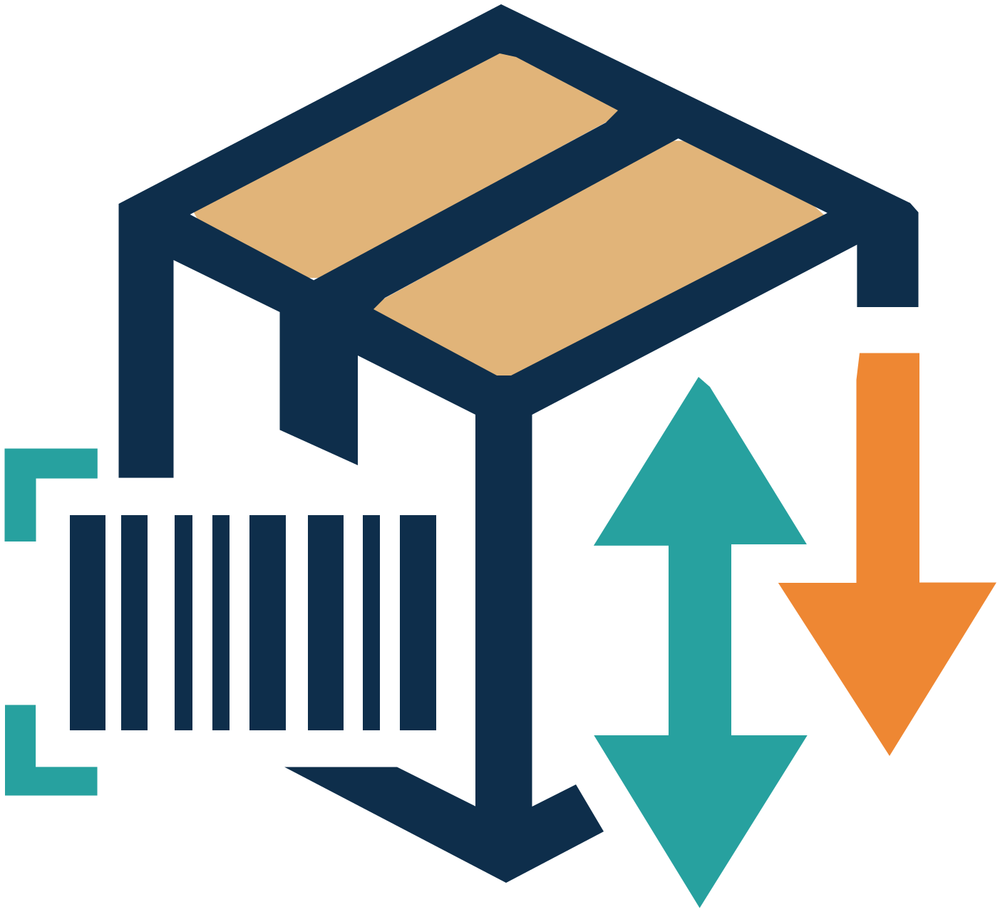

<p align="center"></p>

# noveltyOS

**Inventory, sales, invoices and accounts for small sellers. Works offline, backs up to the cloud, and runs on iPhone and Android.**

noveltyOS is built for businesses that sell novelty and convenience-store merchandise from a garage, a market stall
or the back of a car. Scan a barcode or QR code when stock arrives, scan it again when you sell it, and noveltyOS keeps
stock, cash, customer balances and supplier balances in sync, so there's nothing to balance by hand.

- **One codebase for iOS and Android:** Expo / React Native.
- **Cloud-first, login required:** every user signs in before the app opens, and all business data lives in the cloud.
  Each phone keeps only a synced working copy (erased on sign-out), so scanning and selling keep working with a weak signal.
- **Cloud backup and multi-phone sync:** Supabase (Postgres plus login). Each business's data is isolated with row-level security.

---

## Features

| Area | What it does |
|---|---|
| **Receive Stock** (purchases) | Scan each item, then enter the quantity, your cost and the selling price. New barcodes become new products. Pick the supplier and enter what you paid. The rest goes on that supplier's account (**accounts payable**). |
| **Sell** | Scan items one after another; the camera stays open. Edit quantities or prices, pick a customer or "walk-in", and take Cash, Card or Other. The app shows the change to give, or how much goes on the customer's account (**accounts receivable**). |
| **Invoices and receipts** | Send a full-page invoice or a narrow receipt as a PDF (text, email, WhatsApp), or print it. Each one shows the amount paid, the balance due and the customer's running account balance. |
| **Accounts** | Customers and suppliers with live balances, one-tap **cash payments**, full history, shareable account statements, and starting balances for debts from before noveltyOS. |
| **Inventory** | Search or scan to find a product. Colour-coded stock levels, low-stock alerts and a history of every movement. Items without barcodes are supported. |
| **Dashboard** | Sales, profit, cash in, cash out and **net cash** (what the cash box should have changed by), for today, 7 days or 30 days. Also shows total receivable, total payable and stock value. |
| **Accounts & cloud sync** | Sign in with email and password (email confirmed with a 6-digit code). Every record is saved to the cloud automatically. Add more phones or employees with an **invite code**. Changes sync automatically within seconds when online. |
| **Fixing mistakes** | Void a sale or purchase, or delete a payment. Stock and balances correct themselves. |

### Why the numbers always balance
- Money is stored as whole **cents**, so totals never drift.
- **Balances and stock on hand are never typed in or stored.** They are always calculated from the underlying records:
  ```
  stock on hand    = Σ purchased − Σ sold + Σ count corrections
  customer balance = starting balance + Σ(sale total − paid at sale) − Σ payments received
  supplier balance = starting balance + Σ(purchase total − paid at purchase) − Σ payments made
  ```
  Because of this, two phones selling at the same moment can never overwrite each other's sales.

---

## Run it on your phone

1. Install **Expo Go** from the App Store or Google Play.
2. On a computer with Node.js 20 or later:
   ```bash
   npm install
   npx expo start
   ```
3. Scan the QR code with your phone's camera (iPhone) or with the Expo Go app (Android).

noveltyOS needs its cloud settings to sign in (see the next section). Without them it shows "This build isn't connected to the cloud".

## Turn on the cloud (Supabase, free tier is enough to start)

1. Create a project at [supabase.com](https://supabase.com).
2. Create the database. In **SQL Editor**, paste and run
   [`supabase/migrations/20261118000000_noveltyos_init.sql`](supabase/migrations/20261118000000_noveltyos_init.sql).
   Or, with the Supabase CLI: `npx supabase link` then `npx supabase db push`.
3. **Set up email with Resend.** Supabase's built-in email is for testing only, and template editing needs your own
   email sender.
   1. At [resend.com](https://resend.com) → **Domains → Add domain**. Use a subdomain of a domain you own, for example
      `mail.yourbusiness.com`. Add the DNS records Resend shows at your domain provider and wait for **Verified**.
   2. **API Keys → Create API key**: permission **Sending access**, restricted to that domain. Copy it; it's shown once.
   3. In Supabase: **Authentication → Emails → SMTP Settings → Enable custom SMTP**:
      sender email `no-reply@mail.yourbusiness.com`, sender name `noveltyOS`, host `smtp.resend.com`, port `465`,
      username `resend`, password = the API key. Save.
      **The API key goes only into Supabase. Never put it in the app, `.env` or GitHub.**
   4. **Authentication → Emails → Templates**: paste the templates from
      [`supabase/email-templates/`](supabase/email-templates/) (subjects are in its README). They contain only a
      6-digit code and **no links**.
   5. **Authentication → Sign In / Providers → Email**: keep **Confirm email ON**, set **Minimum password length 8**,
      **Password requirements** = letters and digits, and **Email OTP expiration** = `900` seconds (15 minutes).
   6. **Authentication → Rate Limits**: check the email limit. Supabase raises it once custom SMTP is on; around 100 per
      hour suits a small business.
4. Connect the app. Copy `.env.example` to `.env` and fill in the **Project URL** and **anon / publishable key** from
   *Project Settings → API*, then restart `npx expo start`.
   The anon key is designed to ship inside apps; the database's row-level security is what protects the data.
   **Never** put the `service_role` key in the app.

### How sync works
- **Push:** rows changed on the phone (`dirty = 1`) are uploaded. The flag is cleared only if the row wasn't edited again during the upload.
- **Pull:** rows changed on the server since the last pull are downloaded, ordered by the **server's** clock, so wrong phone clocks don't matter.
  A short overlap window makes sure no change is ever missed.
- Sales, purchases, payments and stock corrections are only ever added or voided, so they never conflict.
  Edits to products, customers and settings use *last upload wins*, and every phone ends up with the same values.
- Deletes are "soft" (`deleted = 1`) so they reach every phone.
- Sync runs 2 seconds after any change, every minute while the app is open, when the app comes back to the screen, and from **Sync now**.

### Security model
- `businesses` and `members` link users to businesses. The owner shares an invite code; the `join_business` function adds staff.
- Every data table has row-level security: a user can only read or write rows of businesses they belong to.
  There is no delete permission at all; deletes happen through the `deleted` flag.
- Only owners can rename the business, remove members or rotate the invite code.

---

## Publish to the App Store and Google Play

**Google Play:** everything for the listing is ready in [`docs/play-store/listing.md`](docs/play-store/listing.md).
It has the store text, Data safety answers, content rating answers, graphics in `docs/play-store/graphics/`,
and a step-by-step release checklist. The privacy policy and account-deletion pages are in [`docs/`](docs/).
Build profiles are in `eas.json`: `preview` makes an installable APK, and `production` makes the App Bundle for Play.


Builds run in the cloud with EAS, so you don't need a Mac. You need an Apple Developer account ($99/yr) and a Google Play Console account ($25 one-time).

```bash
npx eas-cli@latest login
npx eas-cli@latest build:configure
# Add EXPO_PUBLIC_SUPABASE_URL and EXPO_PUBLIC_SUPABASE_KEY as EAS environment variables
# (expo.dev → your project → Environment variables; see https://docs.expo.dev/eas/environment-variables/)
npx eas-cli@latest build --platform all
npx eas-cli@latest submit --platform ios
npx eas-cli@latest submit --platform android
```

The app IDs are `com.noveltyos.app` (`app.json` → `ios.bundleIdentifier` / `android.package`). Change them if that ID is
taken, and replace the icons in `assets/` before you submit.

---

## Brand assets
- `assets/brand/logo.svg`: vector logo, rebuilt from `assets/brand/logo-original.jpg`. Use it for print, web and the store listing.
- Brand colours (also in `src/components/ui.tsx` as `brand`): navy `#0E2E4B`, teal `#27A19F`, orange `#EE8733`, tan `#E1B479`, paper `#F5F7F6`.
  Buttons use a slightly darker teal (`#187A78`) so white text on them stays readable.
- App icons (`assets/icon.png`, `android-icon-*.png`), splash image, favicon and the in-app `logo.png` are all generated from the SVG.

## Development

```bash
npx tsc --noEmit     # typecheck
npx expo lint        # lint
npm test             # bookkeeping tests (real SQLite)
npm run test:cloud   # two-phone sync + security tests against real Postgres
```

`npm run test:cloud` needs a local PostgreSQL (`DATABASE_URL=postgres://postgres@localhost:5432 npm run test:cloud`).
It loads a small stand-in for Supabase's `auth` schema (`tests/supabase-stub.sql`) plus the real migration, then
simulates three phones and three users. It checks simultaneous offline sales, voids, conflicting edits, mid-sync edits,
deletes, late-joining phones and that outsiders can't read or write anything.

### Project layout
```
src/app/                    screens (Expo Router — each file is a screen)
  (tabs)/index.tsx          Home dashboard
  (tabs)/sell.tsx           Sell / cart / checkout
  (tabs)/inventory.tsx      Product list
  (tabs)/people.tsx         Customers & suppliers
  (tabs)/history.tsx        Sales & purchase records
  receive.tsx               Receive stock (purchases)
  product/[id].tsx          Add / edit product + movement history
  party/[id].tsx            Customer/supplier account, payments, statement
  invoice/[id].tsx          Invoice view, share/print, void
  account.tsx               Cloud login, business create/join, sync status
  settings.tsx              Business settings
src/lib/db.ts               Local database schema + all bookkeeping logic
src/lib/sync.ts             Push/pull sync engine (backend-agnostic)
src/lib/supabase.ts         Supabase client + sync adapter
src/lib/cloud-context.tsx   Login state, business linking, auto-sync
src/lib/documents.ts        Invoice / receipt / statement PDFs
src/components/             Scanner, pickers, shared UI
supabase/migrations/        Cloud database schema + security rules
tests/                      Bookkeeping and cloud sync test suites
```

## Roadmap ideas
- Subscriptions/billing per business (e.g. RevenueCat) for selling noveltyOS to other shops.
- Web dashboard for owners (same Supabase backend).
- CSV export for an accountant, PIN lock, Bluetooth receipt printers.
- Staff permissions (e.g. staff can sell but not void).
